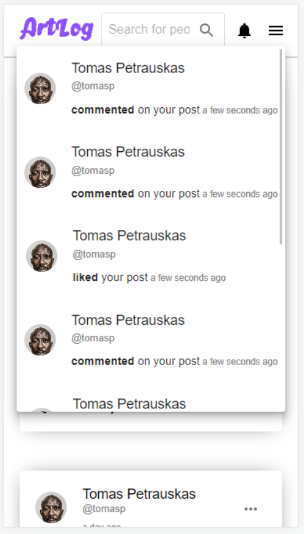
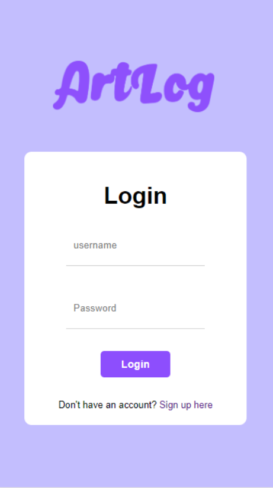

# ArtLog (frontend)

ArtLog is a small social network that works like a shared daily diary. Instead of writing text, people describe their day, their mood, something that happened to them or something they dreamed about. An AI image generator turns that description into a picture, which they share as a post. Each person can post only once per day, and friends can like, comment on and talk about each other's posts.

I built it as a personal learning project, to practice the core parts of a full-stack web app in one place. That includes authentication, a document database, REST APIs, real-time communication with WebSockets, file uploads, scheduled jobs, pagination and a responsive UI. On the product side, it has the features you'd expect from a social network: a feed, friends, likes and comments, search, live notifications and one-to-one chat.

This repository is the React client. The API lives in the separate `artlog-be` repository..

## Running locally

1. Make sure the backend from `artlog-be` is running.
2. Run `npm install`.
3. Create a `.env` file and set `REACT_APP_API` to the backend URL, for example `http://localhost:4200`. There are a few more optional environment values for things like credit limits and hashtag length.
4. Run `npm start`. The app opens on `http://localhost:3000`.

## What the app does

- **Accounts:** people can sign up, log in and log out.
- **Image generation:** people write a prompt and get an AI-generated image. Each generation costs 1 credit. New users start with some credits, everyone gets 3 free credits every day, and the balance is capped at 30.
- **One post per day:** users pick one of their generated images, add hashtags and publish it. Each user can post only once per calendar day in their own time zone. A user who changes time zones has to wait 24 hours since their last post, so switching zones can't be used to post twice.
- **Feed:** shows a user's own posts and their friends' posts, newest first, with infinite scroll.
- **Interactions:** people can like and comment on posts, like comments, and delete their own comments and posts.
- **Search:** find posts by hashtag and people by name or username.
- **Friends:** send, cancel, accept and remove friend requests.
- **Profiles and privacy:** users have profiles with a profile picture and can make their account public or private. Only friends can see a private user's posts or message them.
- **Notifications:** users get real-time notifications when someone likes or comments on their post. The header shows an unread count, and missed notifications load when the app opens.
- **Chat:** real-time one-to-one messaging with full message history.
- **Responsive UI:** works on desktop, tablet and mobile, in Chrome, Safari, Edge and Firefox.

## How it works

The app uses a simple client-server setup:

```
React client  <--HTTP + WebSocket-->  NestJS API  <-->  MongoDB
                                           |
                                           +-->  Stable Diffusion API
```

- **Client:** a single-page React app. It calls the API over HTTP and keeps a Socket.IO connection open for notifications and chat.
- **Server:** a NestJS app that handles business logic and data. It talks to MongoDB and to the image generation API.
- **Database:** MongoDB, accessed through Mongoose.
- **Image generation:** a Stable Diffusion model exposed through an HTTP API, hosted on Google Colab.

## Tech stack

**Frontend:** React 18, TypeScript, React Router, TanStack React Query, Axios, Socket.IO client, MUI, SASS/SCSS, React Toastify

**Backend:** NestJS, TypeScript, MongoDB with Mongoose, Passport (JWT and local strategies), bcrypt, Socket.IO, @nestjs/schedule (cron), class-validator

**Image generation:** Stable Diffusion via the `diffusers` library, hosted on Google Colab

**Tooling:** SonarQube, ESLint, Prettier, Jest

## Screenshots

**Main feed:** posts from a user and their friends, with likes and comments.


**Main feed on mobile:** the same feed in the responsive mobile layout.


**Image generation:** write a prompt, spend a credit, and pick a generated image to post.


**Notifications:** real-time likes and comments on a user's posts.



**Chat:** real-time messaging with friends and public users.


**Login:** the login page.


